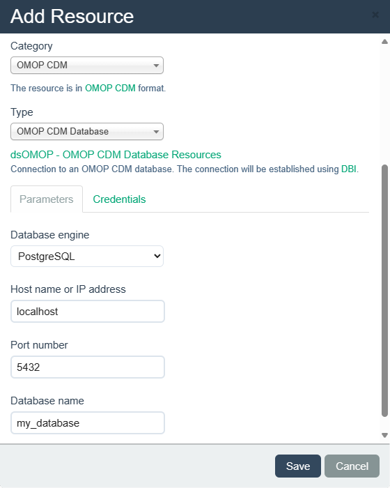

# dsOMOP

## Introduction


The `dsOMOP` package is designed to facilitate interaction with remote databases formatted in the [Observational Medical Outcomes Partnership (OMOP) Common Data Model (CDM)](https://www.ohdsi.org/data-standardization/) from within a [DataSHIELD](https://www.datashield.org/about/) environment. It provides reviewed, typed operations for fetching and transforming data into objects usable by server-side DataSHIELD analyses. Privacy depends on the deployed method allowlist, server options, database privileges and the contract of each operation; installing the package alone is not a blanket disclosure-safety guarantee.

Key features of the `dsOMOP` package include:

- **Typed extraction and transformation:** Reviewed plan, recipe and catalog
  operations for selected OMOP tables, filters and output grains. The package
  deliberately does not expose arbitrary client-authored SQL or joins.
- **DataSHIELD disclosure controls:** Applies distinct-person admission, small-cell suppression, count banding and server-owned policy checks on the reviewed routes that declare those contracts.
- **Support for database interaction:** Includes methods for inspecting table,
  column and concept catalogs and for filtering through typed, reviewed
  criteria. The available operations are intentionally narrower than the full
  relational capabilities of the underlying database.

## Structure

The `dsOMOP` ecosystem comprises two essential components designed to work in tandem: the server-side package (`dsOMOP`) and the client-side package (`dsOMOPClient`). Each component plays a pivotal role in the integration of OMOP CDM databases within the DataSHIELD environment. For comprehensive details on installation, setup, and usage, please refer to the respective repositories:

- **Server-Side package `dsOMOP`**: This component is installed on the DataSHIELD server and is responsible for direct interactions with the OMOP CDM databases. It retrieves and transforms data into protected server-side objects for explicitly reviewed DataSHIELD methods. For code, installation instructions, and more, visit [https://github.com/isglobal-brge/dsOMOP](https://github.com/isglobal-brge/dsOMOP).

- **Client-Side package `dsOMOPClient`**: Utilized by researchers and data analysts, this package facilitates the communication with the `dsOMOP` package on the server. It sends data requests and receives processed data for analysis, ensuring a user-friendly experience for specifying data needs and analysis parameters. For code, installation instructions, and more, visit [https://github.com/isglobal-brge/dsOMOPClient](https://github.com/isglobal-brge/dsOMOPClient).

## Core functionality and differential privacy

dsOMOP's core works exactly as it did before differential privacy (DP) was
added: connecting, loading tables into the DataSHIELD session through plans and
recipes, filters, concept factors, merges and row binding, cohorts, and
dsOMOP's own exploration statistics. It runs under the standard DataSHIELD
disclosure controls (`nfilter.*`) only, and never initializes, consults or
depends on DP in any configuration.

The protected-release service concerns the integrated OHDSI community tools:
Achilles results, OHDSI results tables, the analysis catalog, query library and
typed release channel. Tools and protection are enabled by default and need no
privacy configuration. The default `"auto"` mode selects the registered
protected route; known-disclosive exact fallbacks are unavailable.

Supported complete public bases use `fixed_synopsis`; flexible scopes use
`realised_sticky`, a heuristic disclosure control without a finite transcript-DP
guarantee. Results identify their route, effective public grid, contribution
bounds and unavailable fields. Standard fields retain their DataSHIELD controls;
`"standard"` is an optional mode, while `"dp"` accepts only supported fixed
synopses. Neither mode changes the independent controls on core operations.

The typed release channel accepts only approved, sealed person-local inputs.
Private preparation remains permissive; final publication applies the relevant
`nfilter` and protected-release gates. There are no call limits, budgets,
privacy accountants or history-dependent answers. The only persistent secret
state is the pseudonymisation key and DP noise root. See
[disclosure guarantees and limits](DISCLOSURE_CONTROL.md).

## Installation

To install the server-side package `dsOMOP`, follow the steps below. This guide assumes that you have administrative access to the DataSHIELD server and the necessary permissions to install R packages.

### Prerequisites

The package supplies its declared DataSHIELD methods and default options.
Ordinary database access uses the resource's existing credentials and backend
permissions. Persistent cohort writes are disabled by default. No change to
global privacy levels, database TLS settings or privacy thresholds is needed
for the release's automatic protection.

### Persistent server identity

On first use, dsOMOP automatically creates private state under the R service
user's `~/.dsomop`: directories use mode `0700` and secret files mode `0600`.
The pseudonym root is generated only when an actual OMOP handle first needs it;
the DP noise root is generated on first protected use. Installation and package
loading do not create or embed secrets. Concurrent workers converge on the same
durable root, and subsequent calls and service restarts reuse it automatically.
No administrator provisioning or key rotation is required for ordinary use.

Existing valid per-resource keys and roots are retained. Pseudonym keys are
resource-separated, and raw secret bytes are neither stored in DataSHIELD
handles nor returned to analysts. Public key IDs, provider and epoch identify
incompatible saved objects without revealing the secret. Manipulation preserves
the `dsomop_pseudonymization` contract; merge and row binding reject incompatible
keys, epochs, protocols or resource scopes. Historical objects lacking that
contract are recreated from their resource rather than accepted on the strength
of token-looking strings.

Optional deployments can use `DSOMOP_STATE_DIR`, the `file`, `injected` or
`scoped` pseudonym providers, `DSOMOP_PSEUDONYM_ROOT`, or resource-specific
`DSOMOP_PSEUDONYM_KEY_<resource-hash>` values. The default provider is `auto`.
Explicit option/environment conflicts, weak secrets, unsafe paths and failed
durability checks fail closed. `DSOMOP_PSEUDONYM_REQUIRE_EXISTING=true` is an
optional pre-provisioned-root policy, not an installation prerequisite.
The historical global `DSOMOP_PSEUDONYM_KEY` and raw-key handles remain rejected
unless the explicit legacy-global compatibility opt-in is enabled; this path
retains its cross-resource linkage risk.

State persistence follows the service user's filesystem. Ordinary restart and
package upgrade preserve the existing keys; replacing a container with an empty
home is a different storage lifecycle and is not covered by that guarantee.
Moving or deleting existing state changes key continuity. Root loss or rotation
invalidates existing tokens, and unsafe or substituted roots fail closed.
`DSOMOP_PSEUDONYM_EPOCH` defaults to 1 and is an optional lifecycle marker;
changing it does not itself rotate or derive a key.

### Sticky noise

Pseudonym identity remains separate from differential privacy. dsOMOP provides
a dedicated DP path through `omopDpStatusDS()` and `omopDpReleaseDS()` and never
silently adds noise to ordinary loads, assignments or aggregates. Preparing a
longitudinal dataset and releasing a noisy statistic are distinct operations.
`nfilter.noise` and `datashield.seed` are not DP key material, epsilon settings
or reroll controls.

The DP path accepts only server-created, person-tokened `omop.table` objects
produced by an OHDSI community tool (for example an analysis-catalog loader)
with an authenticated, content-bound, person-local provenance capsule. A copied
class or attribute is not sufficient. Ordinary plan/recipe loads do not carry
DP provenance. The dedicated `omopDpPlanExecuteDS()` preparation path seals
approved person-local plan outputs; final releases validate that provenance
and apply their disclosure gates.

Before adding noise, dsOMOP deterministically collapses or caps repeated
longitudinal records for each person. A release uses one of seven reviewed
person-bounded primitives:

- distinct-person count;
- bounded record count;
- fixed-domain categorical histogram;
- fixed-break numeric, date or datetime histogram;
- bounded distinct-category cardinality;
- bounded mean from bounded, quantized sufficient statistics; or
- binary rate from bounded numerator and denominator statistics.

The statistic specification makes public domains, levels, breaks, bounds,
longitudinal reducer, ordering rule and contribution cap explicit; none is
learned from an exact result. Reducers such as presence, records, first, last,
minimum, maximum, mean, median, mode, any and all are admitted only where their
primitive defines deterministic person-level bounding.

The reference calibration is a fixed server-owned value
(`dsomop.dp.release_epsilon` / `DSOMOP_DP_RELEASE_EPSILON`, default 0.1).
Canonical components receive fixed allocations; this is not an independent
epsilon for every request or cell. The client cannot submit epsilon, delta, a
seed, nonce, epoch, reset or force-reroll flag. Metadata reports the complete
component contract and distinguishes fixed-vector guarantees from heuristic
reuse.

Since dsOMOP 2.6.1, the noise sampler
`dsomop-dp-exact-discrete-laplace-v1` uses the exact integer/rational algorithm
of Canonne, Kamath and Steinke (2020), with exact arbitrary-precision integer
arithmetic in plain R (2.7.0 and 2.7.1 used `gmp`, which draws the same noise
but needs the GNU MP headers to build). It replaces the 52-bit inverse transform, whose finite noise support
invalidated the previous pure-DP claim. Epsilon and sensitivity are the exact
binary rationals represented by their R numbers; there is no decimal rounding
or floating-point probability transform. The noise calibration and output
clipping are unchanged. With independent random bits this implemented
mechanism is pure DP, with delta 0. Its keyed HMAC deployment relies on the
cryptographic pseudorandomness assumption for those bits; this is not a claim
that a finite key supplies information-theoretic infinite randomness. See
[DISCLOSURE_CONTROL.md](DISCLOSURE_CONTROL.md) for the sampler protocol and
exactness argument, and [SAMPLER_DIAGNOSIS.md](SAMPLER_DIAGNOSIS.md) for the
original defect.

Since 2.10.0 the only persistent DP secret is the noise root (the core also
retains its pseudonymisation key). Protected components are determined by the
root, their public owner/profile and bounded contribution fingerprints; fixed
routes additionally use a person-membership digest recomputed inside each
request's database snapshot. No per-handle/session generation or failed-read
cache selects answers. Equivalent supported formulations replay under the same
current data, corpus and secrets. Changes to membership globally redraw fixed
components; clinical edits with unchanged membership redraw changed components.
Change/equality patterns remain informative and have no joint transcript-DP
claim. See [DISCLOSURE_CONTROL.md](DISCLOSURE_CONTROL.md).

Display names, request spelling, scope names, row order and lineage cosmetics
are part of no key. Contribution fingerprints, person tokens and raw PRF
material are never returned. Protection labels report the owner, effective
parameters, allocations, sensitivities, noise scales and guarantee scope.

There is no cumulative epsilon budget, privacy call quota or history-dependent
admission. A repeated question returns its answer instead of fresh noise, so
averaging repeats gains nothing; different questions compose as usual, and the
realised-contribution route is a heuristic disclosure control, not a joint
differential-privacy guarantee. Invalid inputs, unproved provenance, a damaged
root and requests outside the reviewed primitives still fail closed.

The DP service protocol remains `dsomop-dp-release-v3` (policy schema 4, exact
sampler `dsomop-dp-exact-discrete-laplace-v1`, mechanism
`dsomop-sticky-discrete-laplace-prf-v2`). Since 2.10.3 the privacy contract is
`protected_release_fixed_basis_or_realised_v1`; status reports
`release_protocol = "dsomop-protected-release-v1"`,
`release_binding = "fixed_basis_or_realised_contributions_v1"`,
`persistent_state = "noise_root_only"`, `service_capacity = "none"`,
`history_dependent = FALSE`, `history_based_admission = FALSE` and
`privacy_call_quota = "none"`. Typed releases need dsOMOPClient 2.10.3, which
validates and pools protected components; older clients refuse the new
contract. The analysis-catalog questions work with any client (older clients
display protected entries but do not pool them).

dsOMOP 2.7.1 to 2.9.x kept a permanent first-answer store instead
(`DSOMOP_STATE_DIR/release-bindings/`). 2.10.0 no longer reads it, so that historical
upgrade re-drew previously asked questions once. Those files are no longer
part of the active service. `omopInitializeReleaseStore()` remains only as a
deprecated no-op; `dsomop.dp.release_store_id` and
`dsomop.dp.release_store_bytes` are ignored.

Public compatibility labels and client-side packaging of one release do not
mint new noise. Reviewed commutative filters, Boolean aliases and set-valued
arguments are canonicalized. Arbitrary mathematical equivalence between two
different recipes or relational plans is not assumed: distinct authenticated
semantic lineages deliberately receive distinct PRF identities unless dsOMOP
has a reviewed normalization proving them equivalent.

OHDSI QueryLibrary integration is an algorithmic allowlist rather than an SQL
escape hatch. `inst/queries/dp_redesign_registry.json` pins reviewed upstream
questions and maps each admissible question to one of the bounded primitives.
The mapping authorizes the bounded algorithm and its typed parameters, never
the upstream SQL text verbatim. Arbitrary SQL remains blocked and cannot create
an authenticated DP provenance capsule or a new release mechanism.

The DP release channel serves the OHDSI community tools only. It is enabled
by default (`dsomop.dp.enabled`); custodians can opt out with
`options(dsomop.dp.enabled = FALSE)` or `DSOMOP_DP_ENABLED=0`. Explicit option
and environment settings must agree. Since dsOMOP 2.8.0 the custodial option
`dsomop.dp.exclusive` defaults to `FALSE` (profile fallback
`default.dsomop.dp.exclusive = FALSE`) and, when a custodian sets it, applies
only to the community-tool endpoints. With DP enabled, exclusive mode admits
registered fixed-synopsis catalogue/query routes and eligible typed releases;
it refuses standard, realised-only and unsupported tool routes. dsOMOP's own
standard statistics retain their separate controls. Analysts cannot set this
policy or bypass the noise through a client option. `omopDpStatusDS()` reports the configured `exclusive` flag; the
flag is read on each request and does not change the DP mechanism, policy
hash, sticky noise, or release identity.

dsOMOP's own statistics, capabilities (including the banded population size),
structural and vocabulary metadata, and observed concept-factor levels are
always available under the standard controls, whatever the DP settings. See
[DISCLOSURE_CONTROL.md](DISCLOSURE_CONTROL.md) for the endpoint list and the
scope of the gate.

### Automatic release state and freshness

No privacy setting needs configuring. When `dsomop.dp.domain` /
`DSOMOP_DP_DOMAIN` is unset or has an empty package default, initialization
derives it from the connected resource; an explicitly configured value takes
precedence. The public `snapshot_id` status label is a digest of that domain;
the deprecated `dsomop.dp.snapshot_id` / `DSOMOP_DP_SNAPSHOT_ID` only replaces
that display label, and no answer or admission depends on it. The domain is a SHA-256
hash of versioned, canonical database coordinates: normalized DBMS, lowercase
host, effective port, database (canonical absolute file path for SQLite/DuckDB),
and effective CDM and vocabulary schemas. Credentials, transport settings,
resource display names, results schemas and temporary schemas are excluded.
SQLite's implicit and explicit `main` schema have the same identity.

An optional explicit `snapshot_id` is printed as display metadata. With no
valid label, status derives one from the canonical corpus domain only. No
metadata query, noise key, provenance admission or identity decision depends on
the label. Clearing or changing it during a session or after restoring a sealed
table changes neither protection nor values.

Unscoped questions over complete registered public bases use a generation
computed from canonical person membership inside each request's pinned database
snapshot. It detects insertions, withdrawals and balanced replacement of person
identifiers without clinical COUNT/MAX scans or cross-request state. Clinical
edits with unchanged membership retain a component-change residual: the
fingerprint prevents intentional reuse of old noise for changed bounded inputs,
but does not hide which components changed or establish evolving-data DP.
`snapshot_id` has no security or answer effect. Epoch rotation is optional
administrative hardening, never required after a load. Record summaries with
data-enumerated strata use the honestly labelled heuristic route, retain
weighted histograms without scales, and are unavailable in DP-exclusive mode.
See [DISCLOSURE_CONTROL.md](DISCLOSURE_CONTROL.md#the-automatic-data-generation-of-the-fixed-synopses).

Protected recurrent event-time views retain both events and distinct contributors
among the same K=10 kept occurrences. Their complete interval-presence vector has
sensitivity 3K; static epsilon fractions are N/R .2 each, A/B/C .1 each and P .3.
Coarse person counts select their own canonical intervals, never sums of daily
person counts. A versioned radial projection enforces feasible event/person
bounds and interval relationships; retreat toward its event-mass anchor can add
bias. First-event requests remain a separate estimand with unchanged allocations.

Without a configured domain, in-memory databases and unavailable/ambiguous
resource coordinates fail closed because no unambiguous identity is available.
An explicit domain is an optional identity override for those special resources.
Conflicting option and environment values still fail closed. No generic shared fallback domain is used.
Connecting (`omopInitDS()`) never initializes DP; DP binds to the connected
resource when a community tool first uses it. Policy changes during a session
fail closed. Different derived resources have separate sessions; DSLite
server sessions keep separate policies within their shared R process. Optional
explicit identities represent replicas or aliases whose canonical coordinates
differ.

The only DP state is the noise root, automatically created at
`~/.dsomop/secrets/dp_noise_root` under the R service user's home (or an
optional configured state directory). First use draws from the operating-system
CSPRNG, creates private directories/files and logs creation once. A damaged,
unsafe or substituted root fails closed with a stable analyst error and a reason
in the server log. Root continuity follows the service filesystem; loss of the
root changes future draws. The test-only ephemeral-state override is not a
production setting.

Optional injection through `dsomop.dp.noise_root` / `DSOMOP_DP_NOISE_ROOT`
accepts exactly 32 raw CSPRNG bytes or 64 hexadecimal characters, never a
passphrase. With injection, no DP secret file is written. The same root, domain,
epoch, mechanism and data reproduce the same answers. Automatically created
roots separate independent nodes; root bytes never enter handles or responses.

The guarantee is conditional: within one root, domain and epoch, and on
unchanged data, a repeated valid question returns the same canonical bytes,
so repeats add no observation. Different questions, data changes and
rotations compose; there is no finite lifetime privacy accountant or full
temporal-transcript DP claim. Administrative timing, validation failures,
availability and other DataSHIELD outputs remain outside this repeated-payload
guarantee. Method allowlists, person contribution bounds and reviewed output
contracts remain part of the security boundary.

Non-secret configuration is available through matching `dsomop.dp.*` options
and `DSOMOP_DP_*` environment variables, including enablement, domain, the
fixed release epsilon, privacy epoch and the
server caps
for levels, contributions and numeric quantization. Explicit option and
environment values must agree. `omopDpStatusDS()` is suitable as a production
readiness check for the active service and published profile.

The DataSHIELD method allowlist is part of the security boundary. An
`omop.table` class or a `dsomop_protected` attribute protects calls handled by
`dsOMOP`; it cannot make arbitrary methods from other server packages safe.
The effective server-wide method allowlist and privacy options define this
boundary across packages.

`c=base::c` and `list=base::list` are unsafe **aggregate** methods and are
absent from dsOMOP's manifest. In
particular, an aggregate `list` alias lets a caller evaluate `list(x)` and
return an arbitrary server object without passing through a dsOMOP disclosure
gate. dsOMOP transports multiple cohort references through bounded scalar
`scope_cohort_1`, `scope_cohort_2`, ... arguments and multiple analysis tables
through strictly typed `scope_table_1`, `scope_table_2`, ... arguments instead.
An assign-only constructor can be reviewed separately because it does not
itself return its result, but dsOMOP does not require generic constructors for
this workflow.

The boundary covers the effective allowlist for the whole DataSHIELD server,
including methods from other packages. Installing dsFlower, dsVert, or any other package
that exposes either generic constructor in aggregate mode reopens the same
server-wide exfiltration path even though dsOMOP omits it. The client
connection preflight refuses these aliases; direct DSI callers remain outside
that client-side defense.

Third-party analysis packs are a separate administrator trust boundary and are
disabled by default. Optional enablement uses an exact package/version pin,
for example `options(dsomop.analysis_pack_allowlist = c(myPack = "1.2.3"))`.
Discovery ignores every unpinned or version-mismatched package. Enabled entries
must declare a closed versioned output contract; both raw and final aggregate
or assign results pass the external-pack firewall. This controls catalog
outputs, but does not sandbox deliberately malicious R code installed with the
server process's own privileges.

### Package installation

If you prefer using a graphical user interface (GUI) provided by your server for package installation, you can easily install the `dsOMOP` package directly from GitHub. On Opal 6, first enable "Allow R packages management" (Administration > General Settings > Configuration > Edit); it is off by default and package installs are refused until it is on. Navigate to the package installation section in your server's GUI, and specify the following details:

- **User/organization:** `isglobal-brge`
- **Package name:** `dsOMOP`
- **Git reference:** `main`

The R dependencies (`DBI`, `R6`, `resourcer`, `jsonlite`, `filelock`,
`openssl`, `RSQLite`) are installed automatically. The database driver is
separate: PostgreSQL needs `RPostgres` (shipped in the DataSHIELD Rock image)
or `RPostgreSQL`, MySQL/MariaDB `RMariaDB`, SQL Server, Snowflake and Spark
`odbc`, DuckDB `duckdb`; install a missing one as an R package on the server. Built from source, they need
no system libraries beyond the OpenSSL and libcurl headers that Opal/Rock
images already include for `openssl` and `resourcer`. If the GUI reports
nothing, the R server log (for Rock, its container log) shows the R output of
the installation.

#### Installing from the R console

If you are using an Opal server and have access to an administrator account, you can install the package from the R console using the `opalr` package. If you do not have the `opalr` package installed, you can install it using the following command:
```R
install.packages("opalr")
```

To create a login object for the server, change the following code to match your specific server details and administrator credentials:
```R
library(opalr)

# Change the URL and credentials to match your Opal server and administrator account!
o <- opal.login(username = "administrator", password = "password", url = "https://opal-demo.obiba.org/")
```

You can then install the `dsOMOP` package using the following command:
```R
dsadmin.install_github_package(o, 'dsOMOP', username='isglobal-brge', ref='main')
```

#### Upgrading to 2.10.3 on Opal

The release pairs dsOMOP 2.10.3 with dsOMOPClient 2.10.3. It includes the
OHDSI protected-release corrections and recipe language 2. Existing secrets are
reused automatically; no state-directory setting, privacy tuning, epoch bump,
ETL hook or TLS change is part of this upgrade.

Opal distinguishes the installed R package from the DataSHIELD profile. On an
upgrade, the profile retains the old methods and options until the package
settings are published (Administration > DataSHIELD > Packages > dsOMOP >
Publish, also available as `dsadmin.publish_package(o, 'dsOMOP')`). This is the
ordinary Opal package-publication lifecycle. `ds.omop.server.version(conns)`
reports installed and published versions and distinguishes a stale profile from
an old package. A stale profile is refused before assignment; publishing an
already installed 2.10.3 makes its protocol available without another upgrade.

Supported legacy recipes retain their v1 execution path. Language-2 plans need
the publication protocol at every site; corrected and newly refused v1 shapes
and their migration paths are listed in [NEWS.md](NEWS.md). New protected
payloads are not pooled with pre-2.10.3 payloads; `type = "split"` retains
per-site results during a mixed-version transition. Older typed clients receive
a clear upgrade refusal. The new client alone cannot repair an old server.

Protected answers can change with the repaired component contracts and grids.
Historical releases are not retracted. Fixed-vector and heuristic guarantees,
exact support gates and the remaining adaptive-inference limits are described
in [DISCLOSURE_CONTROL.md](DISCLOSURE_CONTROL.md#upgrading-to-2103).

## Creating OMOP CDM resources

The resources used by dsOMOP are of the type `omop.dbi.db`, which hold the connection details to OMOP CDM databases. Each declared database engine has its own resource factory: `postgresql`, `mysql`, `mariadb`, `sqlserver`, `synapse`, `pdw`, `oracle`, `redshift`, `bigquery`, `snowflake`, `spark`, `databricks`, `sqlite` or `duckdb`.

These resources contain the following parameters:
- `host`: The hostname or server/account identifier. For BigQuery this field is
  the GCP project ID.
- `port`: The port number on which the database server is listening.
- `database`: The database name (the BigQuery dataset). For file-based engines
  (SQLite, DuckDB) this is the path to the database file, and `host`/`port` are
  omitted.
- `cdm_schema` (optional): The schema holding the OMOP CDM tables. Defaults to
  the engine default (for PostgreSQL, `public`); when that schema holds no
  `person` table, the single schema that does is used (OHDSI Broadsea keeps its
  CDM in `demo_cdm`). When several schemas hold one, the connection stops and
  lists them: name the CDM schema in the resource.
- `vocabulary_schema` (optional): The schema holding the vocabulary tables.
  Defaults to the CDM schema, or to the single schema holding `concept` when
  the CDM schema has none.
- `results_schema` (optional): The schema holding cohorts, Achilles and other
  OHDSI result tables. Auto-detection is limited and should be pinned when the
  deployment uses a separate results daimon.
- `warehouse` / `driver` (backend-specific, optional): Snowflake warehouse or
  an ODBC driver-name override.
- TLS is optional and never required by default: the DataSHIELD server and
  the database sit inside the data owner's domain, often on one machine or one
  Docker network. A resource that leaves its TLS settings empty connects the
  way the driver does by default.
- PostgreSQL TLS options `sslmode`, `sslrootcert`, `sslcert` and `sslkey`.
  Without `sslmode` no mode reaches libpq, whose default (`prefer`, or
  `PGSSLMODE` when the R server sets it) uses TLS only when the database offers
  it. Optional modes `require`, `verify-ca` and `verify-full` enforce TLS.
- MySQL/MariaDB TLS options `ssl_required`, `ssl_ca`, `ssl_cert` and `ssl_key`.
  TLS is required, with a verified server certificate, only when
  `ssl_required=true` or TLS material is set; an optional `ssl_ca` supplies the
  server CA is not already in the connector trust store. dsOMOP disables
  RMariaDB option-file groups so a host-level client configuration cannot
  change this. Required TLS sessions must negotiate TLS 1.2 or TLS 1.3.
- SQL Server, Synapse and PDW through Microsoft's ODBC drivers connect with
  `Encrypt=no` and `TrustServerCertificate=yes`, so Driver 18 does not require
  TLS either.

Where the backend uses username/password authentication, credentials are not URL
parameters: they are supplied separately as the resource identity and secret.
BigQuery and file-backed engines use the service account's configured cloud or
filesystem identity instead.

The resource uses these connection details to access the OMOP CDM database.

Resources created with the dsOMOP 1.x form (format `omop.cdm.db`, URL
`postgresql://host:port/db//dsomop::/schema:cdm/vocabulary_schema:vocab`, also
`mysql://` and `mariadb://`) keep working: dsOMOP reads them as the equivalent
2.x resource, with the same checks. The form only creates 2.x resources;
re-create old ones with it whenever convenient.

### Database support contract

The factories above are connector and SQL-adapter contracts, not a claim of
feature parity on every vendor/version. Database execution uses DBI directly;
`DatabaseConnector` is not a runtime dependency. dsOMOP's own generated SQL
uses its reviewed local subset (`TOP`, day `DATEADD`/`DATEDIFF`, and Oracle's
bare-alias syntax). Separately,
controller-owned canonical OHDSI SQL can use the official optional `SqlRender`
render/translate path. That path fails closed when `SqlRender` or the requested
dialect is unavailable and never falls back silently to the smaller local
translator. MySQL/MariaDB are a reviewed dsOMOP extension rather than an OHDSI
SqlRender target.

| Backend | R driver | Metadata path | Cross-statement temporary object | Verification in this repository |
|---|---|---|---|---|
| PostgreSQL | RPostgres; RPostgreSQL fallback | privilege-filtered `pg_catalog` | `pg_temp` session table | live PostgreSQL 16 CI with separate schemas |
| SQLite | RSQLite | SQLite catalogs, including attached schemas | session temp table | executable integration tests |
| DuckDB | duckdb | DBI/`information_schema` | session temp table | optional executable tests when installed |
| MySQL / MariaDB | RMariaDB | `information_schema`, preserving case-sensitive physical names | `DROP TEMPORARY TABLE` lifecycle | live MySQL 8.4 and MariaDB 11.4 CI with separate databases |
| SQL Server / Synapse / PDW | odbc | `information_schema` | unavailable for dsOMOP cross-statement recipes | SQL contract tests only |
| Oracle | ROracle or odbc | Oracle catalogs | unavailable for dsOMOP cross-statement recipes | SQL contract tests only |
| Redshift | RPostgres | `information_schema` | unavailable cross-statement | SQL contract tests only |
| BigQuery | bigrquery | dataset-qualified `INFORMATION_SCHEMA` | unavailable for dsOMOP cross-statement recipes | SQL contract tests only |
| Snowflake | odbc | `information_schema` with Snowflake casing | unavailable cross-statement | SQL contract tests only |
| Spark / Databricks | odbc | `SHOW TABLES` / `DESCRIBE TABLE` | unavailable cross-statement | SQL contract tests only |

The vendor workflow exercises PostgreSQL, MySQL and MariaDB through their real
drivers, with distinct CDM, vocabulary and results namespaces plus same-named
decoy tables that detect routing bleed. It covers metadata discovery, filters,
date translation, vocabulary lookup, cohort/results routing, one reviewed
analysis-catalog query, repeated-event `intervals_long`, temporal covariates,
observation-aware person-period panels, survival/competing-risk/recurrent-event/
counting-process/multi-state formats, bounded-chunk staging (including the
stateful multi-state transform) and session temporary tables. A
site must still test its exact authentication, roles, permissions and server
version before production use. Other network
backends remain SQL-contract-only. Operations that need a temporary cohort or
working relation fail explicitly on backends whose safe cross-statement
materialisation is not implemented; simple metadata or single-statement queries
may still work. The `database_support` element returned in the server
capabilities reports this adapter profile.

### OHDSI alignment and interoperability

The implementation follows OMOP table/field semantics and uses the following
OHDSI assets, but "aligned" does not mean that every HADES package is embedded:

- OMOP CDM metadata are vendored from official `CommonDataModel` releases:
  [v5.3.2 commit `dd85c0d30bb3dd4bd16c5dbef7dbf9dd93075fa2`](https://github.com/OHDSI/CommonDataModel/commit/dd85c0d30bb3dd4bd16c5dbef7dbf9dd93075fa2)
  and [v5.4.2 commit `aa047a3c620b5c842b4370a0c965e2aa72203b1d`](https://github.com/OHDSI/CommonDataModel/commit/aa047a3c620b5c842b4370a0c965e2aa72203b1d).
  `inst/ohdsi/UPSTREAM_METADATA.json` pins each CSV SHA-256. If
  `CommonDataModel` is installed, its published CSV metadata can supply another
  explicitly supported version. An unknown version fails closed. Non-standard
  tables/columns are invisible unless the controller lists them in
  `dsomop.allowed_cdm_extensions`. That list grants visibility, not identifier
  semantics: unknown extension `*_id`, `*_key`, and `*_identifier` fields remain
  blocked (also when sensitive-column access is enabled); person keys are
  pseudonymized and explicitly listed `*_concept_id` fields retain their OMOP
  concept semantics.
- The package can consume standard cohort/result tables and selected Achilles
  results. Some catalog analyses are local ports with OHDSI-inspired IDs or
  output shapes; they are not calls into Achilles, CohortMethod,
  FeatureExtraction or other HADES packages.
- Every aggregate catalog entry exposes a closed, typed pooling contract to the
  client. Contracts identify grouping keys, presentation labels, additive
  sufficient statistics, reconstructible ratios and moments, inverse-variance
  effects, Kaplan-Meier risk sets, or an explicit non-poolable estimand. Physical
  OHDSI result tables have a separate reviewed contract endpoint, so a live
  catalog overlay can never be mistaken for the requested stored result table.
  Standard concept IDs, rather than human-readable labels, define cross-site
  identity when both are available.
- Two-arm CohortMethod ports use the pinned upstream default
  `keep first, truncate to second`: the first treatment in time wins, its era is
  truncated before the second starts when they overlap, and same-day first
  treatments are excluded. Both effective arms are re-gated before modelling;
  only the protected `cohort_overlap` diagnostic intentionally retains the raw
  arms. This contract is audited against OHDSI CohortMethod commit
  [`dd1a2a856ef608547a99d3db2d60d5c872f80dc6`](https://github.com/OHDSI/CohortMethod/blob/dd1a2a856ef608547a99d3db2d60d5c872f80dc6/inst/sql/CreateOrCountCohorts.sql#L62-L106).
- Circe/ATLAS JSON interoperability is a documented subset implemented by
  dsOMOPClient. `CirceR` and `CohortGenerator` are not runtime dependencies, and
  the package does not promise arbitrary Circe expression execution. Age
  criteria deliberately use the same annual expression as OHDSI Circe
  (`YEAR(event_date) - person.year_of_birth`), rather than silently inventing a
  birthday from nullable OMOP month/day fields; see the audited Circe-be source
  at [commit `498893689a9cf4f09c2a43cc893bb01116db7184`](https://github.com/OHDSI/Circe-be/blob/498893689a9cf4f09c2a43cc893bb01116db7184/src/main/java/org/ohdsi/circe/cohortdefinition/builders/ConditionOccurrenceSqlBuilder.java#L173-L176).
  Index-event cohorts likewise use the unique observation period covering the
  event as their default end. The supported Circe `DateOffset` subset can use
  `StartDate` or `EndDate` plus an integer day offset, always capped at the
  observation-period end; `EndDate + 0` requests the source-event end. This
  follows the audited [Circe cohort-end builder](https://github.com/OHDSI/Circe-be/blob/498893689a9cf4f09c2a43cc893bb01116db7184/src/main/java/org/ohdsi/circe/cohortdefinition/CohortExpressionQueryBuilder.java#L332-L338).
- Longitudinal analyses use OMOP's native repeated-row model: every source row
  remains a distinct fact and can attach to each compatible recurrent cohort
  episode. Public analytical time is deliberately `calendar_day`; same-day
  facts remain distinct and are ordered internally by their OMOP primary key,
  while source row identifiers and cross-episode linkage tokens stay private.
  A named person-level OHDSI estimand is the explicit exception: it selects one
  deterministic index episode per person and pre-aggregates recurrent outcomes,
  so repeated outcome facts can increase event counts without multiplying that
  person's time at risk.
- Multi-state plans accept the transition-matrix convention used by `mstate`
  and return its expanded `(Tstart, Tstop]` risk-set shape, class/`trans`
  attribute in memory, plus an explicit transition reference for Parquet
  interchange. This is interoperable with the experimental
  [OHDSI OmopMultistate snapshot](https://github.com/OHDSI/OmopMultistate/tree/51f40d41470c14f6e7bf86e1ee5334d244f5c0b8),
  but does not depend on it: dsOMOP keeps source events in schema-qualified SQL
  and feeds an ordered bounded-memory state machine instead of collecting the
  full event history into R. The public graph may contain cycles; it is fixed by
  the analyst and never inferred from private site data. Repeated observations
  of one state on one calendar day collapse to one state observation; public
  `priority` or `sequential` policies resolve distinct states observed that day.
  Sequential staged output labels its unit as
  `calendar_day_with_public_within_day_offsets`; the fractions are analytic,
  not observed timestamps.
  Across all longitudinal survival formats, malformed or incompletely observed
  episodes are excluded by SQL eligibility rules and the resulting eligible
  population is re-gated with the ordinary DataSHIELD person threshold. They do
  not create query-selective data-quality errors that could be used to probe
  private dates or event integrity.
- Sparse and temporal-covariate outputs use a FeatureExtraction-style shape,
  including reference tables, but are not FeatureExtraction `CovariateData`
  objects and do not implement its complete settings/covariate universe.
- FeatureExtraction analysis IDs and concept/code references used by local score
  adapters are audited against
  [v3.14.0 commit `53266f0233c2ee7cae127e8669ad35b0d60406ae`](https://github.com/OHDSI/FeatureExtraction/commit/53266f0233c2ee7cae127e8669ad35b0d60406ae).
  The adapters are explicitly not upstream-equivalent: they use
  `condition_occurrence`, local vocabulary/descendant rules and dsOMOP date
  semantics instead of FeatureExtraction's `condition_era`, cohort-relative
  windows and index-specific inclusion/exclusion SQL. The analysis-catalog
  comorbidity entry is a one-point-per-component burden approximation, not a
  published Charlson/DCSI/CHADS2/CHA2DS2-VASc/HFRS implementation.
- Standard concept IDs follow OMOP vocabulary semantics, but dsOMOP does not
  make different site vocabulary snapshots equivalent. Descendant/mapped
  expansion and local mappings must be versioned and compared for a federated
  phenotype.
- The Query Library is a local curated catalog, not a vendored or automatically
  synchronized copy of OHDSI QueryLibrary. A machine-readable per-query audit
  pins [upstream commit `df8a21074b08519e581ca1afb7510468538117a4`](https://github.com/OHDSI/QueryLibrary/commit/df8a21074b08519e581ca1afb7510468538117a4),
  file hashes, dependencies, output risks and redesign triage so drift is
  detectable; it does not enable any upstream query or imply local template
  lineage. See `inst/queries/QUERY_REFERENCE.md` for provenance and the backlog.

### Staged outputs

`output_mode = "staged"` stores outputs in a private server-local directory and
assigns descriptors instead of final in-session data frames. Arrow produces one
Parquet file from bounded DBI fetches and row groups; without Arrow the fallback
is CSV. SQL-backed long-event, interval, survival,
temporal-covariate and person-period components stream without materialising
the complete result in R. Wide/features, baseline, person-level and other
in-memory outputs are still materialised before staging.

The path is readable only by the server OS identity (directory `0700`, files
`0600`). A descriptor is neither a client download URL nor a general export
permission. Another package running as the same OS account may implement the
reviewed descriptor contract; it should resolve files through
`omopStagedDatasetPath()` rather than trust the embedded path. That resolver
checks token confinement, type, expiry, owner-only permissions and the optional
non-secret pseudonym-key ID/epoch (required for person-bearing files). Every v2
plan descriptor must also carry a canonical component semantic contract (output
type/format/grain plus age/date semantics) and an output-level bundle contract.
The bundle binds sibling files to the same logical output and high-entropy
staging token without incorrectly requiring `personRef`, reference and sparse
components to have the same shape. The resolver accepts
`expected_semantic_contract` for exact same-shape comparisons and
`expected_bundle_contract` for compatible sibling comparisons; either mismatch
fails before a consumer opens the file. Comparing those contracts and key
identity prevents invalid combinations after policy, key or replica changes. A
different service account needs a separately reviewed broker.
Person-bearing staged output requires a resource-scoped provider; the deprecated
global legacy key is retained for historical in-memory tokens but is rejected
at this broader interoperability boundary.
The owner-only v2 `manifest.json` stores complete descriptors (including token,
origin, pseudonymization, component semantics and bundle semantics) with
explicit JSON nulls. Internal `.readStagingManifest()` reconstructs and resolves
each descriptor through the same validation path, rather than treating a
partial manifest projection as an authority.
Row/byte/output/directory limits and TTL cleanup reduce resource exhaustion, but
production deployments still need filesystem quotas and a controller-owned
periodic cleanup job.

Extraction shape is also bounded before expensive R-side expansion. The
server defaults are `dsomop.max_feature_specs = 1000`,
`dsomop.max_pivot_concepts = 1000`, `dsomop.max_output_columns = 5000` and
`dsomop.max_temporal_bins = 10000`, plus filter depth/nodes/values of
32/1,024/10,000, 100 outputs per plan and 256 live temporary tables per handle.
They bound explicit features, wide/sparse/temporal expansion, recursive filter
work, multi-output amplification and session-owned database state. These are
controller-configurable operational resource caps, not statistical disclosure
parameters. A federated request uses the lowest compatible advertised plan cap;
each server independently enforces its handle-state cap.

### Creating resources from GUI

dsOMOP modifies the interface provided by the Opal server to incorporate an option in its resource creation panel dedicated to OMOP CDM databases. This allows users to easily configure and manage resources specifically designed for OMOP CDM databases directly from the GUI.

To use it, simply access the management dashboard of a project and go to the `Resources` subsection. In the `Add Resource` option, you will find the `OMOP CDM` category:

<p align="center">
  
</p>

### Creating resources from the R console

If you are using an Opal server and have access to an administrator account, you can create the OMOP CDM resources from the R console using the `opalr` package. If you do not have the `opalr` package installed, you can install it using the following command:
```R
install.packages("opalr")
```

To create a login object for the server, change the following code to match your specific server details and administrator credentials:
```R
library(opalr)

# Change the URL and credentials to match your Opal server and administrator account!
o <- opal.login(username = "administrator", password = "password", url = "https://opal-demo.obiba.org/")
```

You can then use the following function to create an OMOP CDM resource. The `factory` argument selects the database engine (here `postgresql`):
```R
opal.resource_extension_create(o,
  project = "my_project",
  name = "my_resource",
  provider = "dsOMOP",
  factory = "postgresql",
  parameters = list(
    host = "localhost",
    port = 5432,
    database = "my_database",
    cdm_schema = "cdm",
    vocabulary_schema = "vocab"
  ),
  credentials = list(
    username = "my_username",
    password = "my_password"
  )
)
```

## Extending backend support

Adding a DBMS is not only a resource-factory change. A production adapter needs
a reviewed connection path, identifier/schema qualification, metadata discovery,
SQL translation, date arithmetic, temporary-object semantics, reconnect tests
and executable integration tests. Until that full contract exists, an adapter
should be described as experimental rather than as supported feature parity.

## Acknowledgements

- The development of dsOMOP has been supported by the **[RadGen4COPD](https://github.com/isglobal-brge/RadGen4COPD)**, **[P4COPD](https://www.clinicbarcelona.org/en/projects-and-clinical-assays/detail/p4copd-prediction-prevention-personalized-and-precision-management-of-copd-in-young-adults)**, **[CADSET](https://www.ersnet.org/science-and-research/clinical-research-collaboration-application-programme/cadset-chronic-airway-diseases-early-stratification/)**, and **[DATOS-CAT](https://datos-cat.github.io/LandingPage)** projects. These collaborations have not only provided essential financial backing but have also affirmed the project's relevance and application in significant research endeavors.
- This project has received funding from the **[Spanish Ministry of Education, Innovation and Universities](https://www.ciencia.gob.es/en/)**, the **[National Agency for Research](https://www.aei.gob.es/en)**, and the **[Fund for Regional Development](https://ec.europa.eu/regional_policy/funding/erdf_en)** **(PID2021-122855OB-I00)**. We also acknowledge support from the grant **CEX2023-0001290-S** funded by **MCIN/AEI/10.13039/501100011033**, and support from the **[Generalitat de Catalunya](https://web.gencat.cat/en/inici/index.html)** through the **[CERCA Program](https://cerca.cat/en/)** and the **Consolidated Group on HEALTH ANALYTICS (2021 SGR 01563)**.
- Additionally, this project has received funding from the **[Instituto de Salud Carlos III (ISCIII)](https://www.isciii.es/)** through the project **"PMP21/00090,"** co-funded by the **[European Union's](https://european-union.europa.eu/index_en)** **Resilience and Recovery Facility**. It has also been partially funded by the **"Complementary Plan for Biotechnology Applied to Health,"** coordinated by the **[Institut de Bioenginyeria de Catalunya (IBEC)](https://ibecbarcelona.eu/)** within the framework of the **Recovery, Transformation, and Resilience Plan (C17.I1)** – Funded by the **[European Union](https://european-union.europa.eu/index_en)** – **[NextGenerationEU](https://next-generation-eu.europa.eu/index_en)**.

- This project **(PID2021-122855OB-I00)** has received funding from **MCIN /AEI /10.13039/501100011033 / FEDER, UE**.

<p align="center">
  
</p>

## Contact

For further information or inquiries, please contact:

- **Juan R González**: juanr.gonzalez@isglobal.org
- **David Sarrat González**: david.sarrat@isglobal.org

For more details about **DataSHIELD**, visit [https://www.datashield.org](https://www.datashield.org).

For more information about the **Barcelona Institute for Global Health (ISGlobal)**, visit [https://www.isglobal.org](https://www.isglobal.org).
